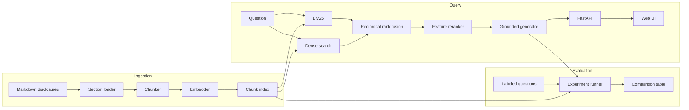

# CiteGround

Citation-grounded question answering over a public filing-style corpus. Ask a question, get an answer that points at the passage it came from, and measure whether retrieval actually found that passage.

The corpus is synthetic. Helios Systems, Inc. is not a real issuer. The documents follow the shape of a Form 10-K and a shareholder letter so the system has stable, citable facts. They are not SEC filings and they are not investment advice.

No API key is required. Embeddings, the reader, the tests, and the numbers below all run offline. Set `OPENAI_API_KEY` when you want the same prompt sent to `gpt-4o-mini` and the same interface backed by `text-embedding-3-small`.

## Architecture



Sections are the labeled unit. Chunkers may split a section, and every chunk keeps the section id, so the experiments below compare chunking strategies without relabeling.

`docs/WALKTHROUGH.md` walks through each box in the language you would use in an interview.

## Quickstart

Python 3.11 or newer.

```bash
python3 -m pip install -e ".[dev,vector]"
python3 -m citeground.cli.ingest
python3 -m pytest
python3 -m ruff check .
python3 -m citeground.cli.evaluate
```

`citeground-ingest` writes `data/index/` (`manifest.json`, `chunks.jsonl`, `vectors.npy`). That directory is gitignored. Rebuild it whenever the corpus or the chunker changes.

Ask a question once the index exists:

```bash
python3 -m citeground.cli.serve
```

Open [http://127.0.0.1:8000](http://127.0.0.1:8000). The page talks only to this API. A Streamlit client is the same thin view, and it needs the `ui` extra:

```bash
python3 -m pip install -e ".[ui]"
python3 -m streamlit run ui/streamlit_app.py
```

`POST /v1/answer` takes `question`, `mode` (`hybrid`, `bm25`, or `dense`), and `top_k`. The response carries the answer, the citation markers, the passages, per-stage latency, token counts, and a cost figure. `GET /v1/health` and `GET /v1/metrics` report whether the index is loaded and what the process has spent. Each response sets `x-trace-id`, and the same id is appended to `data/traces/traces.jsonl`.

With no API key the reader is an extractive offline model: it quotes the retrieved sentences that overlap the question and abstains when the passage does not cover the question. It does not invent a number. Set `OPENAI_API_KEY` to send the same prompt to `gpt-4o-mini`. Cost on the offline path is zero and is labeled `offline-zero`. Cost on the OpenAI path is tokens times the list prices in `.env.example`, labeled `list-price-estimate`, not an invoice.

```bash
curl -s http://127.0.0.1:8000/v1/answer \
  -H 'content-type: application/json' \
  -d '{"question":"What was fiscal 2024 revenue compared with fiscal 2023 revenue?"}'
```

Docker builds the index on first boot and serves the same UI:

```bash
docker compose up --build
```

Useful overrides:

```bash
python3 -m citeground.cli.ingest --chunker fixed --chunk-size 500 --overlap 80
python3 -m citeground.cli.ingest --embedding hashing --vector-store numpy
```

Set `OPENAI_API_KEY` and `--embedding openai` to embed with `text-embedding-3-small` instead. See `.env.example`. Do not commit a filled-in `.env`.

Regenerate the comparison table without re-running retrieval:

```bash
python3 scripts/compare_experiments.py artifacts/eval/results.json
```

## Evaluation

These numbers were produced by `python3 -m citeground.cli.evaluate` on this machine with no API key. The judge is `offline-deterministic`. Embeddings are `hashing` / `signed-hash-tf`. The reader is `mock` / `mock-extractive`. The set is `data/eval/qa.jsonl`: 28 questions, 27 answerable, 1 meant to abstain. The full rows are in `artifacts/eval/per_question.jsonl`. The same table is in `artifacts/eval/comparison.md`.

| Experiment | Recall@5 | Recall@10 | MRR | Faithfulness | Answer relevance | Citation support | Abstention accuracy |
| --- | ---: | ---: | ---: | ---: | ---: | ---: | ---: |
| bm25-recursive-900 | 0.981 | 1.000 | 0.901 | 1.000 | 0.633 | 1.000 | 1.000 |
| dense-hash-recursive-900 | 0.926 | 1.000 | 0.819 | 1.000 | 0.613 | 1.000 | 1.000 |
| hybrid-rerank-recursive-900 | 1.000 | 1.000 | 0.926 | 1.000 | 0.653 | 1.000 | 1.000 |
| hybrid-rerank-fixed-500 | 1.000 | 1.000 | 0.944 | 0.992 | 0.649 | 1.000 | 1.000 |

Recall and MRR are averaged over the 27 answerable questions. Recall@k is the fraction of gold sections present in the top k chunks. Two questions have two gold sections (`q-customer-a`, `q-northline-price`), so a stack that finds only one of them scores 0.5 on that question. MRR is the reciprocal rank of the first chunk whose section is gold.

How to read the table:

- BM25 on recursive 900-character chunks is already strong. Its only Recall@5 miss is `q-customer-a`: the Customer A risk factor is in the top 5, and the customers section that states the same 11 percent is not. Recall@10 is 1.000, so the section is retrieved, just not high enough.
- Hashed TF embeddings alone are worse. They miss `q-capex` and `q-customer-count` in the top 5 (MRR 0.100 on those two, so the right section is around rank 10). The hashing trick has no synonymy. It is a stand-in so the dense channel exists in CI, not a claim about `text-embedding-3-small`.
- Hybrid retrieval plus the feature reranker is the default product stack. Recall@5 is 1.000 and MRR rises from 0.901 to 0.926 against the BM25 baseline.
- Smaller fixed windows (`hybrid-rerank-fixed-500`) have the best MRR, 0.944. Faithfulness drops from 1.000 to 0.992 because of one question, `q-northline-revenue`. A 500-character window sliced the sentence at `$71 million`, the reader quoted the fragment ending in `$7`, and that question's faithfulness is 0.789. The intact sentence is quoted next to it.

Faithfulness and citation support are 1.000 on the three recursive stacks for a mechanical reason. The offline reader only emits sentences copied from the cited passage, and both metrics score token overlap with that passage. They check that the citation path is wired correctly. They are not an LLM's judgment that a generated answer is grounded, and they are not RAGAS scores. The LLM-judge path exists (`python3 -m citeground.cli.evaluate --judge llm`) and was not run, because that call needs an API key. Those scores are not in this table.

Answer relevance is the number that moves. It is token-F1 against the gold answer, macro-averaged over all 28 questions. 0.653 on the default stack means the quoted sentence usually contains the fact and also contains extra filing prose the gold answer does not. The weak cases on that stack are `q-litigation` (0.240: the reader quotes the "no loss contingency" sentence and a sentence about where the allegation is discussed, and misses the allegation itself) and `q-fy2023-filing` (0.350: it quotes a pointer sentence and the hardware breakout instead of the sentence that states total revenue). The dividend question is abstained, which is what the label asks for. Abstention accuracy is 1.000 because that is the only such question.

## Retrieval

Hybrid mode takes the top candidates from BM25 and from dense search and fuses them with reciprocal rank fusion (`k = 60`). BM25 scores and cosine similarity are not on the same scale, so fusion uses rank rather than a weighted sum of raw scores.

The reranker then rescores that pool with query-term coverage, normalized BM25, and cosine similarity. It is a linear model over features the retriever already computed. It is not a cross-encoder. A hosted cross-encoder can replace `rerank()` without changing the candidate generator.

Dense search defaults to an exact NumPy inner product over L2-normalized vectors, which is the right algorithm at this corpus size. Install the `vector` extra and set `CITEGROUND_VECTOR_STORE=faiss` to use FAISS `IndexFlatIP`. The scores match NumPy on the same vectors. An approximate FAISS index is the swap to make once exact search shows up in the latency budget.

## Chunking

| Strategy | What it does |
| --- | --- |
| `recursive` | Packs paragraphs up to the character budget, and falls back to sentences and then fixed windows. This is the default. |
| `fixed` | Character windows with overlap. Ignores paragraph boundaries. |
| `sentence` | Sliding window of N sentences. |

No strategy crosses a `##` section. Headings may set a stable id with a trailing `{slug}`. Those ids are what `data/eval/qa.jsonl` points at.

## Design trade-offs

- **Offline embeddings are lexical.** The hashing embedder gives CI a dense channel without a key or a model download. The table shows the cost: dense-only Recall@5 is 0.926 against BM25's 0.981. Retune the reranker weights when the OpenAI embedder is on. Do not treat the hashing column as a semantic-search result.
- **BM25 is rebuilt on load.** This corpus is small enough that rebuilding postings is cheaper than operating an incremental inverted index. A persisted index belongs here once ingestion is incremental.
- **Section labels, not chunk offsets.** Chunk boundaries move when the chunk size changes. Section ids do not. That is why fixed-500 and recursive-900 can share one labeled set.
- **The corpus is synthetic and small.** Recall@5 of 1.000 will not survive contact with EDGAR. The loader reads any Markdown directory with the same front matter, so a real public corpus can be pointed at `CITEGROUND_CORPUS_DIR` without changing retrieval.
- **The offline reader is extractive.** It will not paraphrase well, and it will abstain rather than fill a gap. Answer relevance of 0.653 is the honest score for that choice. The OpenAI model sees the same grounded prompt. Its quality is not claimed here.
- **Faithfulness of 1.000 is a property of the reader, not a trophy.** A generative model scored by an LLM judge will not post that number on this set, and this repo does not pretend it did.
- **Traces are a JSONL file and an in-process counter.** Enough to see latency, tokens, and cost per answer. A collector such as OpenTelemetry is the export step, not a requirement for the accounting itself.

## Layout

```
src/citeground/ingest/        loader, chunkers, pipeline
src/citeground/index/         on-disk index, NumPy and FAISS search
src/citeground/retrieval/     BM25, fusion, rerank, hybrid retriever
src/citeground/llm/           hashing embedder, OpenAI embedder, extractive offline reader
src/citeground/generation/    grounded prompt, citation parsing
src/citeground/api/           FastAPI app and the web UI
src/citeground/observability/ JSON logs, traces, cost
src/citeground/eval/          metrics, judges, experiment runner
data/corpus/                  synthetic Helios disclosures
data/eval/qa.jsonl            labeled questions
artifacts/eval/               offline results, committed
docs/WALKTHROUGH.md           component-by-component interview notes
ui/streamlit_app.py           optional second client
```

## License

MIT.
