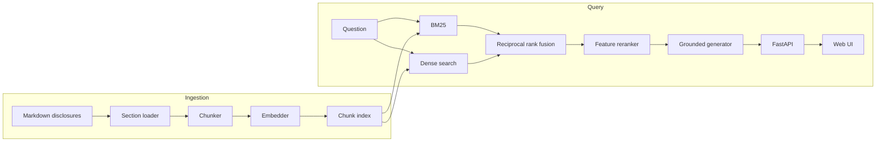

# CiteGround

Citation-grounded question answering over a public filing-style corpus. Ask a question, get an answer that points at the passage it came from, and measure whether retrieval actually found that passage.

This repository is the retrieval and ingestion layer: load Markdown disclosures, chunk them without crossing section boundaries, embed them, and retrieve with BM25, a dense index, reciprocal rank fusion, and a feature reranker. The HTTP API, the small web UI, and the evaluation harness sit on top of this index.

The corpus is synthetic. Helios Systems, Inc. is not a real issuer. The documents follow the shape of a Form 10-K and a shareholder letter so the system has stable, citable facts. They are not SEC filings and they are not investment advice.

## Architecture



Sections are the labeled unit. Chunkers may split a section, and every chunk keeps the section id, so a later evaluation can compare chunking strategies without relabeling.

## Quickstart

Python 3.11 or newer. No API key is required. With no key, embeddings use a signed feature-hashing encoder that runs entirely offline.

```bash
python3 -m pip install -e ".[dev,vector]"
python3 -m citeground.cli.ingest
python3 -m pytest
python3 -m ruff check .
```

`citeground-ingest` writes `data/index/` (`manifest.json`, `chunks.jsonl`, `vectors.npy`). That directory is gitignored. Rebuild it whenever the corpus or the chunker changes.

Ask a question once the index exists:

```bash
python3 -m citeground.cli.serve
```

Open [http://127.0.0.1:8000](http://127.0.0.1:8000). The page talks only to this API. A Streamlit client is the same thin view, and it needs the `ui` extra:

```bash
python3 -m pip install -e ".[ui]"
python3 -m streamlit run ui/streamlit_app.py
```

`POST /v1/answer` takes `question`, `mode` (`hybrid`, `bm25`, or `dense`), and `top_k`. The response carries the answer, the citation markers, the passages, per-stage latency, token counts, and a cost figure. `GET /v1/health` and `GET /v1/metrics` report whether the index is loaded and what the process has spent. Each response sets `x-trace-id`, and the same id is appended to `data/traces/traces.jsonl`.

With no API key the reader is an extractive offline model: it quotes the retrieved sentences that overlap the question and abstains when none do. It does not invent a number. Set `OPENAI_API_KEY` to send the same prompt to `gpt-4o-mini`. Cost on the offline path is zero. Cost on the OpenAI path is tokens times the list prices in `.env.example`, labeled `list-price-estimate`, not an invoice.

```bash
curl -s http://127.0.0.1:8000/v1/answer \
  -H 'content-type: application/json' \
  -d '{"question":"What was fiscal 2024 revenue compared with fiscal 2023 revenue?"}'
```

Docker builds the index on first boot and serves the same UI:

```bash
docker compose up --build
```

Useful overrides:

```bash
python3 -m citeground.cli.ingest --chunker fixed --chunk-size 500 --overlap 80
python3 -m citeground.cli.ingest --embedding hashing --vector-store numpy
```

Set `OPENAI_API_KEY` and `--embedding openai` to embed with `text-embedding-3-small` instead. See `.env.example`. Do not commit a filled-in `.env`.

## Retrieval

Hybrid mode takes the top candidates from BM25 and from dense search and fuses them with reciprocal rank fusion (`k = 60`). BM25 scores and cosine similarity are not on the same scale, so fusion uses rank rather than a weighted sum of raw scores.

The reranker then rescores that pool with query-term coverage, normalized BM25, and cosine similarity. It is a linear model over features the retriever already computed. It is not a cross-encoder. A hosted cross-encoder can replace `rerank()` without changing the candidate generator.

Dense search defaults to an exact NumPy inner product over L2-normalized vectors, which is the right algorithm at this corpus size. Install the `vector` extra and set `CITEGROUND_VECTOR_STORE=faiss` to use FAISS `IndexFlatIP`. The scores match NumPy. An approximate FAISS index is the swap to make once exact search shows up in the latency budget.

## Chunking

| Strategy | What it does |
| --- | --- |
| `recursive` | Packs paragraphs up to the character budget, and falls back to sentences and then fixed windows. This is the default. |
| `fixed` | Character windows with overlap. Ignores paragraph boundaries. |
| `sentence` | Sliding window of N sentences. |

No strategy crosses a `##` section. Headings may set a stable id with a trailing `{slug}`. Those ids are what a labeled question set should point at.

## Design trade-offs

- **Offline embeddings are lexical.** The hashing embedder gives CI a dense channel without a key or a model download. It will not retrieve a paraphrase that shares no tokens. The OpenAI embedder is the production encoder, and the hybrid weights should be retuned when it is turned on.
- **BM25 is rebuilt on load.** This corpus is small enough that rebuilding postings is cheaper than operating an incremental inverted index. A persisted index belongs here once ingestion is incremental.
- **Section labels, not chunk offsets.** Chunk boundaries move when the chunk size changes. Section ids do not. Recall measured on sections stays comparable across experiments.
- **The corpus is synthetic and small.** That is a choice for reproducibility, not a claim that the same recall will hold on EDGAR. The loader reads any Markdown directory with the same front matter, so a real public corpus can be pointed at `CITEGROUND_CORPUS_DIR` without changing retrieval.
- **The offline reader is extractive.** It will not paraphrase well, and it will abstain rather than fill a gap. That is the behavior you want when the alternative is a fluent wrong number. The OpenAI model sees the same grounded prompt.
- **Traces are a JSONL file and an in-process counter.** Enough to see latency, tokens, and cost per answer. A collector such as OpenTelemetry is the export step, not a requirement for the accounting itself.

## Layout

```
src/citeground/ingest/       loader, chunkers, pipeline
src/citeground/index/        on-disk index, NumPy and FAISS search
src/citeground/retrieval/    BM25, fusion, rerank, hybrid retriever
src/citeground/llm/          hashing embedder, OpenAI embedder, extractive offline reader
src/citeground/generation/   grounded prompt, citation parsing
src/citeground/api/          FastAPI app and the web UI
src/citeground/observability/ JSON logs, traces, cost
ui/streamlit_app.py          optional second client
data/corpus/                 synthetic Helios disclosures
```

## License

MIT.
